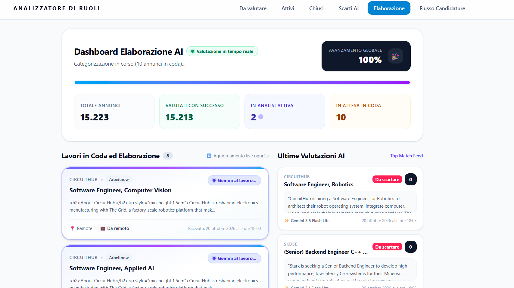
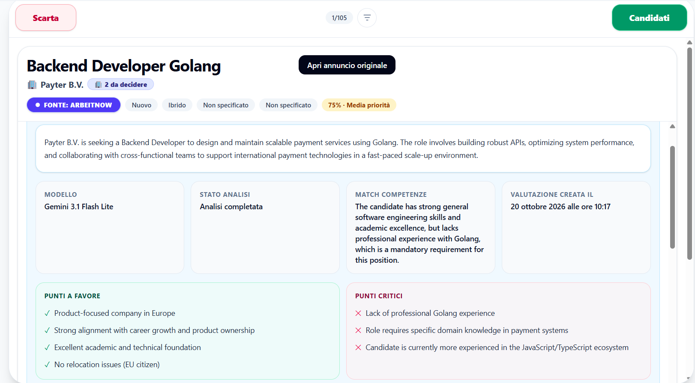
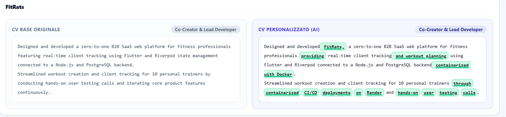
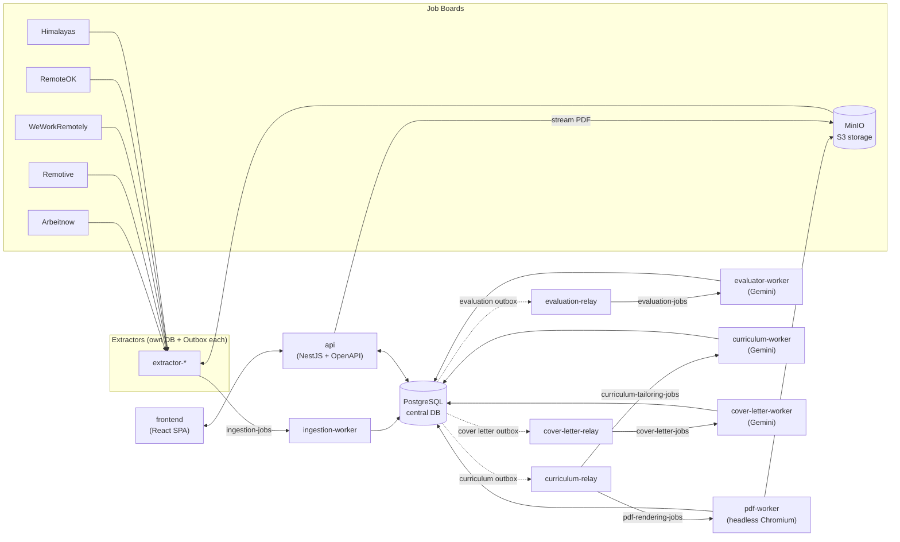

# Analizzatore di Ruoli

**An event-driven, AI-powered job search platform.**
It continuously collects job offers from multiple boards, scores each one against a candidate profile using Google Gemini, and, on demand, generates a tailored CV (rendered to PDF) and cover letter for the offers worth applying to.

> *"Analizzatore di Ruoli"* is Italian for *"Role Analyzer"*.

I built it to automate my own job search across Europe. Reading hundreds of listings by hand doesn't scale, so I let a pipeline of workers and LLMs filter out the noise. That leaves me free to focus on the roles that actually fit.

---

## 🎬 Demo

▶️ **[Watch the demo video](docs/media/demo.mp4)**

<!-- To embed the video inline on GitHub: edit this README in the GitHub web editor, drag & drop docs/media/demo.mp4 here, and replace the link above with the generated https://github.com/user-attachments/... URL. -->

### Real-time AI processing dashboard
Live view of the evaluation pipeline: global progress, queued and in-flight jobs, and the latest Gemini verdicts. It has processed 15k+ offers so far.



### Decision dock
A triage view for the offers that pass AI filtering. Each one shows a summary, a match score and priority, and the pros and cons generated by Gemini. One click either discards it or moves it into the application flow.



### AI resume tailoring
A side-by-side diff of the base CV and the version Gemini tailored for a specific offer. Changes are highlighted so they can be reviewed before the PDF is generated.



---

## ✨ What it does

- **Multi-source ingestion**: Independent extractors pull offers from **Arbeitnow, Remotive, Jobicy, WeWorkRemotely, RemoteOK and Himalayas**.
- **Deduplication**: A single ingestion worker normalizes, deduplicates and upserts every offer into a central database. Ingestion is idempotent.
- **AI evaluation**: Each new offer is scored by Gemini against the candidate's CV and free-text search criteria. Structured JSON output covers fit, seniority, company type and hard deal-breakers.
- **Resume tailoring**: The base CV is rewritten for a specific offer by an LLM, rendered with headless Chromium, and stored as a PDF on S3-compatible storage (MinIO).
- **Cover letter generation**: Cover letters are generated per offer through a dedicated pipeline.
- **Dashboard**: A React SPA to browse, filter and analyze offers and companies, inspect evaluations and preview the generated documents.

---

## 🏗️ Architecture

The system is a **pnpm monorepo of small, single-purpose NestJS microservices**. They communicate asynchronously through **BullMQ (Redis)** queues. Every hop between a database write and a queue goes through the **Transactional Outbox pattern**. This gives at-least-once delivery without dual-write inconsistencies.



### Services

| Component | Responsibility |
| :--- | :--- |
| [`packages/contracts`](packages/contracts) | Shared TypeScript types, DTOs, BullMQ queue names and event payloads |
| [`packages/database`](packages/database) | Central Prisma schema, migrations and generated client |
| [`services/api`](services/api) | REST API gateway (NestJS, Swagger/OpenAPI, Prisma) |
| [`services/extractors/*`](services/extractors) | One extractor per job board, each with an isolated DB and outbox |
| [`services/ingestion-worker`](services/ingestion-worker) | Idempotent ingestion, normalization and deduplication of offers |
| [`services/evaluation-relay`](services/evaluation-relay) | Polls the evaluation outbox and dispatches to BullMQ |
| [`services/evaluator-worker`](services/evaluator-worker) | Scores offers with Gemini (structured JSON output) |
| [`services/curriculum-relay`](services/curriculum-relay) | Dispatches CV tailoring and PDF rendering jobs |
| [`services/curriculum-worker`](services/curriculum-worker) | LLM-based resume tailoring |
| [`services/pdf-worker`](services/pdf-worker) | HTML → PDF rendering with headless Chromium and upload to MinIO |
| [`services/cover-letter-relay`](services/cover-letter-relay) | Dispatches cover letter jobs |
| [`services/cover-letter-worker`](services/cover-letter-worker) | LLM-based cover letter generation |
| [`frontend`](frontend) | React 19 + Vite SPA |
| [`k8s`](k8s) | Kustomize manifests for the whole stack |

---

## 🧠 Engineering highlights

- **Transactional Outbox + dedicated relays**: Business writes and outbox events are committed in the same Prisma transaction. Polling and dispatch run only in separate relay services, so CPU-heavy workers (LLM calls, Chromium) never block delivery, and each side scales independently.
- **Idempotent consumers**: Workers rely on unique constraints and upserts, so at-least-once delivery is safe.
- **LLM resilience without fake fallbacks**: Transient provider errors (429/503/504) are propagated to BullMQ, which retries with exponential backoff. Entities are only marked `FAILED` once retries are exhausted, and quota errors never are. The workers never return silent static fallbacks.
- **Multi-model quota pooling**: The evaluator uses round-robin across several Gemini models and a BullMQ rate limiter sized to the combined RPM budget.
- **Database per extractor**: Extractors are fully decoupled from the central schema and from each other.
- **End-to-end type safety**: Backend DTOs → OpenAPI spec → generated frontend types (`openapi-typescript` + `openapi-fetch`).
- **No binaries in the DB**: PDFs live in MinIO. The API streams them to the browser through a proxy endpoint.

---

## 🛠️ Tech stack

| Area | Technologies |
| :--- | :--- |
| **Backend** | TypeScript, Node.js, NestJS, Prisma, BullMQ |
| **AI** | Google Gemini (structured output) |
| **Data & storage** | PostgreSQL, Redis, MinIO (S3-compatible) |
| **Documents** | Headless Chromium / Puppeteer |
| **Frontend** | React 19, Vite, TypeScript, TanStack Query, Jotai, Tailwind CSS, Radix UI, d3-sankey |
| **Infrastructure** | Docker, Kubernetes (k3d / k3s), Kustomize, Traefik ingress |
| **Tooling** | pnpm workspaces, OpenAPI codegen, oxlint |

---

## 🚀 Running locally

**Prerequisites:** Node.js, pnpm, Docker, [k3d](https://k3d.io) and kubectl.

```bash
pnpm install

# 1. Create the local Kubernetes cluster (with a local registry on :5001)
pnpm cluster:create

# 2. Configure secrets (DB, MinIO, Gemini API key)
cp k8s/secrets.yaml.example k8s/secrets.yaml

# 3. Build, push and deploy every service
pnpm k8s:deploy

# 4. Check status
pnpm k8s:status
```

The app is then served through the Traefik ingress at `http://localhost`. The frontend is on `/` and the API and Swagger docs are under `/api`.

### Customizing the candidate profile

Evaluation and tailoring are driven by a free-text **candidate profile**: a CV plus search criteria and deal-breakers. It lives in [`packages/contracts/src/user-profile.config.ts`](packages/contracts/src/user-profile.config.ts).

The file ships with my own profile as a working example. Replace `resumeText` and `searchCriteriaText` with yours to point the evaluator at your own job search.

---

## 📚 Documentation

Architectural decisions and per-service conventions are indexed in [`docs/guidelines-index.md`](docs/guidelines-index.md), including:

- [Architecture & monorepo rules](docs/architecture.md)
- [Transactional Outbox pattern](docs/outbox-pattern.md)
- [AI workers, retries & resilience](docs/ai-workers.md)
